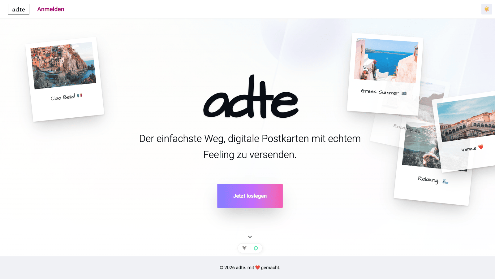
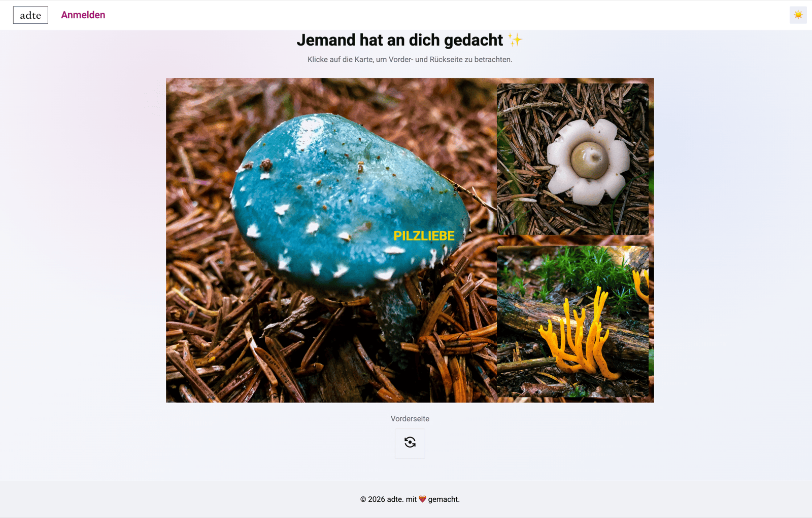

# adte

Digitale Postkarten, die sich wie echte anfühlen. Mit adte gestaltest du persönliche Postkarten aus Bildern, Text, Stickern und Sprachnachrichten und verschickst sie per Link oder E-Mail – auf Wunsch zeitgesteuert.

**Live:** [adte.juka.dev](https://adte.juka.dev) · Konzept, Design und Entwicklung von [Juliette Kauflin](https://github.com/JuKa2023)



## Features

- Login mit Google
- Vorder- und Rückseite frei gestalten: Hintergrundbild (Upload oder Mood-Vorlage), Bilder, Text, Emoji-Sticker
- Sprachnachricht aufnehmen
- Optionaler Standort-Stempel mit aktuellem Wetter
- Hoch- und Querformat
- Teilen per privatem Link oder Versand per E-Mail, sofort oder geplant
- Eigene Galerie mit Entwürfen und gesendeten Karten



## Tech Stack

- [Vue 3](https://vuejs.org/), [TypeScript](https://www.typescriptlang.org/), [Vite](https://vite.dev/), [Tailwind CSS](https://tailwindcss.com/)
- [PocketBase](https://pocketbase.io/) für Auth, Datenbank, Dateien und den E-Mail-Versand (Cron-Hook)
- [BigDataCloud](https://www.bigdatacloud.com/) und [Open-Meteo](https://open-meteo.com/) für den Standort-Stempel

## Lokale Entwicklung

Voraussetzungen: Node.js 20.19+ und die [PocketBase](https://github.com/pocketbase/pocketbase/releases/tag/v0.40.6) Binary (`0.40.6`) unter `bin/pocketbase`.

```sh
# Backend
npm run pb

# Frontend
cp .env.example .env.local
npm install
npm run dev
```

Im PocketBase Admin UI (<http://127.0.0.1:8090/_/>):

1. **Google OAuth** unter *Collections → users → Options → OAuth2* aktivieren. Redirect-URL in der Google Cloud Console: `http://127.0.0.1:8090/api/oauth2-redirect`
2. **SMTP** unter *Settings → Mail settings* konfigurieren, damit der Hook `pb_hooks/sendScheduledPostcards.pb.js` E-Mails versenden kann.

Migrationen in `pb_migrations/` werden beim Start automatisch angewendet.

## Deployment

Das `Dockerfile` baut das Frontend und liefert es zusammen mit PocketBase als ein einzelner Container aus. `pb_data` muss auf einem persistenten Volume liegen.

```sh
docker build -t adte .
docker run -p 8080:80 -e PUBLIC_APP_URL=http://localhost:8080 -v adte_data:/pb/pb_data adte
```

| Variable | Beschreibung |
| --- | --- |
| `PUBLIC_APP_URL` | Öffentliche URL der App, wird für Links in E-Mails verwendet |
| `RESEND_API_KEY` | Optional: versendet E-Mails über die Resend API statt SMTP (z. B. auf Hosts ohne SMTP) |
| `TRUSTED_PROXY_HEADER` | Optional: Header mit der Client-IP hinter einem Proxy, z. B. `CF-Connecting-IP` bei Cloudflare |
| `PB_ENCRYPTION_KEY` | 32 Zeichen, verschlüsselt die gespeicherten Settings (SMTP-Passwort, OAuth-Secret) |
| `VITE_POCKETBASE_URL` | Nur für die lokale Entwicklung, in Produktion wird der eigene Origin verwendet |
